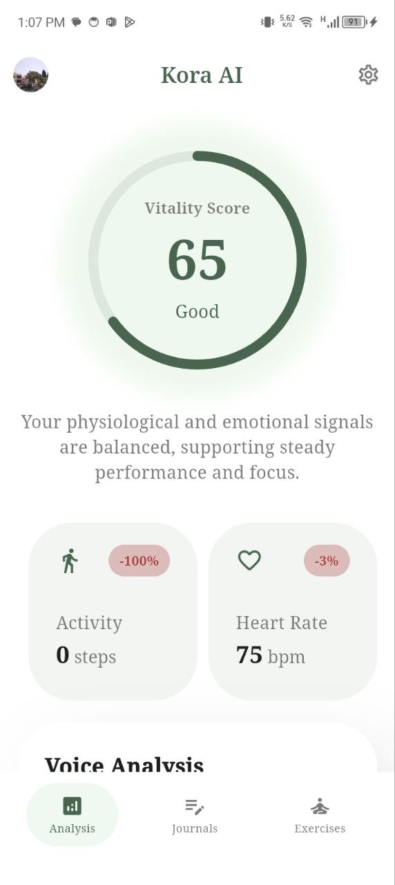
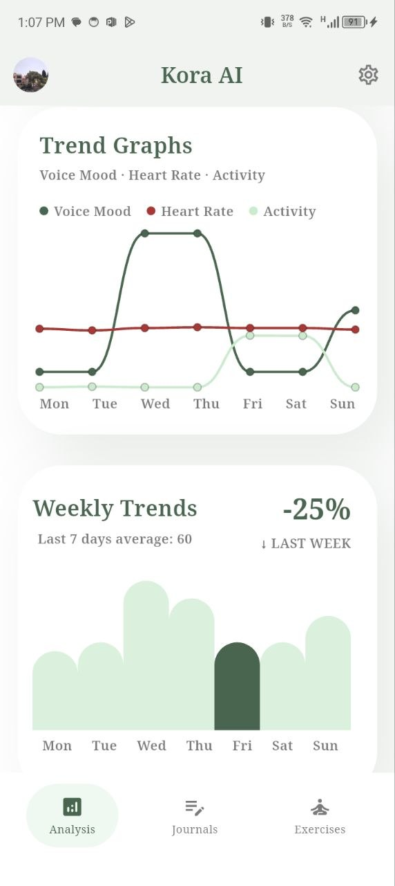
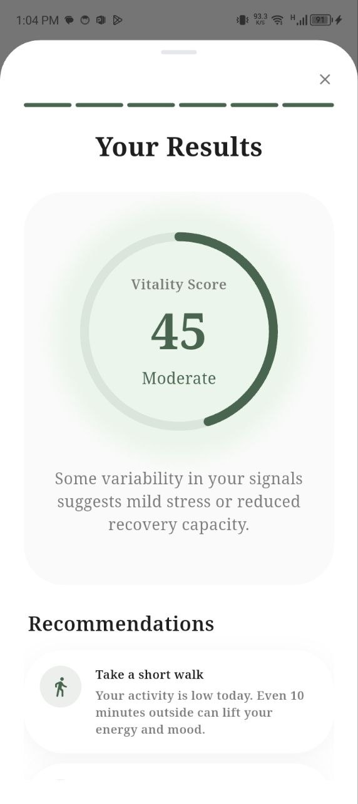

<div align="center">

# 🌿 Kora AI
### Privacy-First, AI-Powered Wellness Companion

**Flutter · Dart · BLoC · Clean Architecture · TensorFlow Lite · Firebase · Health Connect**

[](https://flutter.dev/) [](https://dart.dev/) [](https://ai.google.dev/edge/litert) [](https://firebase.google.com/)

### 🎬 [Watch the Kora AI Demo](https://youtu.be/5kfD7rmvgtA?si=5DRV73hu4cTpiN2E)

*Developed during a Flutter Mobile Developer internship at **INTALIO** and presented as a **Master 2 thesis in Web Development at the Lebanese University**.*

</div>

---

## ✨ About Kora AI

Kora AI is a privacy-conscious wellness application built with Flutter. It brings together voice emotion analysis, heart-rate and activity inputs, and optional journal text to provide a unified **Vitality Score** and a more rounded view of everyday well-being.

Its speech-emotion recognition pipeline runs **on-device** through TensorFlow Lite, allowing voice inference without sending recordings to a cloud inference service.

> Kora AI is a wellness project, not a medical diagnostic application.

## 🎥 Demo

▶️ **[Watch the full Kora AI demo on YouTube](https://youtu.be/5kfD7rmvgtA?si=5DRV73hu4cTpiN2E)**


## 📸 Application Screenshots

| Dashboard | Analytics | Results |
|:---:|:---:|:---:|
|  |  |  |


## 🚀 Highlights

- **On-device speech-emotion recognition:** Audio capture, Mel-spectrogram processing, and TensorFlow Lite inference.
- **Multi-input wellness analysis:** Combines voice emotion, heart rate, activity and optional text in the Vitality Score.
- **Health integration:** Uses Android Health Connect through Flutter's `health` package.
- **Journaling and activities:** Dedicated features for journal entries and exercises.
- **Authentication and profiles:** Firebase-backed services for account-related flows.
- **Maintainable Flutter architecture:** BLoC-based state management and separation of application concerns.

## 📊 Speech Emotion Model — Reported Results

| Metric | Result |
|---|---|
| Accuracy | **85.2%** on a speaker-disjoint test set |
| Model size | **97.2 MB → 8.2 MB** |
| Size reduction | **~92%** |
| Inference time | **~302 ms** on a lower-mid-range Android device |
| Inference runtime | TensorFlow Lite, on-device |

The audio preprocessing pipeline was reimplemented in Dart to support offline mobile inference. These performance figures are from the project's reported evaluation, not benchmarks automatically generated by this repository.

## 🧱 Architecture & Project Organization

The application uses feature-oriented folders and supporting core modules:

```text
lib/
├── core/
│   ├── common/
│   ├── di/
│   ├── theme/
│   └── utils/
├── features/
│   ├── analysis/
│   ├── auth/
│   ├── exercises/
│   ├── journals/
│   ├── main_shell/
│   ├── new_journal_entry/
│   ├── onbording/
│   ├── profile/
│   └── settings/
├── firebase_options.dart
└── main.dart
```

The codebase uses **BLoC** (`flutter_bloc`), dependency injection (`get_it`), and clean-architecture tooling to organize presentation, business logic, and data concerns.

## 🛠️ Technology Stack

| Area | Technologies / packages |
|---|---|
| App | Flutter, Dart |
| State & architecture | `flutter_bloc`, `equatable`, `clean_arch`, `get_it` |
| On-device AI & audio | `tflite_flutter`, `record`, `fftea` |
| Health data | `health` (Android Health Connect) |
| Firebase | Authentication, Cloud Firestore, Storage |
| Location | `geolocator`, `geocoding` |
| Local preferences | `shared_preferences` |
| Notifications | `flutter_local_notifications` |

The model and label files are declared in `pubspec.yaml` as `assets/ser_model.tflite` and `assets/labels.txt`.

## 🏁 Getting Started

### Prerequisites

- Flutter SDK compatible with **Dart SDK ^3.9.2**
- Android Studio or VS Code with Flutter tooling
- Android device/emulator and appropriate permissions for supported health/audio features
- Working Firebase project configuration where required

### Run locally

```bash
# Clone
git clone https://github.com/janassaadeh/kora.git
cd kora

# Install packages
flutter pub get

# Launch
flutter run
```

**Setup note:** Firebase, permissions, and Android Health Connect may require device- and project-specific configuration. The included Firebase options relate to a particular project; use your own configuration when deploying a separate instance.

## 🔐 Privacy Approach

Kora AI's voice emotion inference is designed to execute locally rather than uploading audio to a remote model for prediction. Other app services (such as Firebase) may process their respective data; on-device inference should not be understood as a claim that the entire application is offline or that all user information remains on-device.


This project combines practical mobile engineering, edge ML integration, and applied academic work.

## 👩‍💻 Developer

**Jana Saadeh** — Flutter Developer | Mobile Software Engineer

[Portfolio](https://janasaadeh.com/) · [LinkedIn](https://www.linkedin.com/in/jana-saadeh-123j/) · [GitHub](https://github.com/janassaadeh) · [Demo](https://youtu.be/5kfD7rmvgtA?si=5DRV73hu4cTpiN2E)

---

*Built with an emphasis on mobile usability, maintainable architecture, and privacy-conscious AI.*
